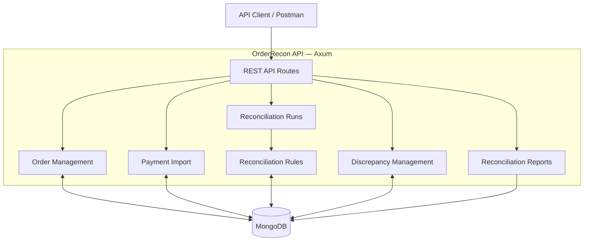

# OrderRecon

A backend API for reconciling e-commerce orders against payment transactions.

OrderRecon compares order records with captured payment records to identify missing payments, amount or currency mismatches, duplicate payments, and payments that reference nonexistent orders. It provides reconciliation run summaries, discrepancy tracking, and reporting through a REST API built with Rust, Axum, and MongoDB.

## Features

- **Order management** — Create, list, and retrieve orders.
- **Payment imports** — Import payment transactions in batches and report imported, duplicate, and rejected records.
- **Automated reconciliation** — Compare orders with captured payment transactions.
- **Discrepancy tracking** — Find, filter, and review reconciliation discrepancies.
- **Resolution workflow** — Mark discrepancies as resolved or ignored with a resolution note.
- **Reconciliation history** — Retrieve previous reconciliation runs and their summaries.
- **Reporting** — View discrepancy counts grouped by type and resolution status.
- **Pagination and validation** — Paginated list endpoints and structured error responses.
- **MongoDB indexes** — Initialize database indexes when the application starts.
- **Automated tests** — Integration tests for API behavior and reconciliation rules.

## Technology Stack

- **Language:** Rust (Edition 2024)
- **Web framework:** Axum
- **Database:** MongoDB
- **Async runtime:** Tokio
- **Serialization:** Serde and Serde JSON
- **Configuration:** dotenvy
- **Logging:** tracing and tracing-subscriber
- **Testing:** Rust test framework and Tower utilities

## Reconciliation Rules

OrderRecon uses integer minor units to represent monetary values. For example, `150000` represents PHP 1,500.00.

Only payments with the `captured` status are considered during reconciliation.

| Condition | Result |
|---|---|
| Exactly one captured payment matches the order amount and currency | Matched order |
| No captured payment exists for an order | `missing_payment` |
| More than one captured payment references an order | `duplicate_payment` |
| One captured payment has a different currency | `currency_mismatch` |
| One captured payment has a different amount | `amount_mismatch` |
| A captured payment references an order that does not exist | `unmatched_payment` |

When multiple captured payments reference the same order, the duplicate-payment rule takes priority over amount comparison. The discrepancy records the associated payment IDs and the sum of their amounts for investigation; that sum is not used to decide whether the order matches.

Payments with `pending`, `failed`, or `refunded` status are excluded from reconciliation.

Order statuses are `placed`, `fulfilled`, and `cancelled`. The current reconciliation process compares orders regardless of their order status.


## Architecture


### Request Flow

1. **Order and payment ingestion:** Clients create orders and import payment transactions through the REST API.
2. **Reconciliation:** A client triggers a reconciliation run. The service loads orders and captured payments from MongoDB and applies the reconciliation rules.
3. **Discrepancy recording:** Missing payments, mismatches, duplicate payments, and unmatched payments are saved as discrepancies associated with the run.
4. **Review and reporting:** Clients retrieve run summaries, filter discrepancies, and record resolution decisions.

Reconciliation runs execute synchronously through the API request. The current implementation does not use a background job queue.


## Project Structure
```text
orderrecon/
├── src/
│   ├── config.rs
│   ├── database.rs
│   ├── lib.rs
│   ├── main.rs
│   ├── models/
│   │   ├── discrepancy.rs
│   │   ├── order.rs
│   │   ├── payment.rs
│   │   └── reconciliation_run.rs
│   ├── routes/
│   │   ├── discrepancies.rs
│   │   ├── orders.rs
│   │   ├── payments.rs
│   │   ├── reconciliation_report.rs
│   │   └── reconciliation_runs.rs
│   └── services/
│       ├── reconciliation.rs
│       └── reconciliation_rules.rs
├── tests/
├── postman/
├── .env
├── Cargo.toml
├── Cargo.lock
└── README.md
```


## Prerequisites

- Rust toolchain and Cargo
- MongoDB running locally or an accessible MongoDB instance
- Postman (optional, for API testing)

## Configuration

Create a `.env` file in the project root:

```env
APP_HOST=127.0.0.1
APP_PORT=8001
MONGODB_URI=mongodb://127.0.0.1:27017
MONGODB_DATABASE=orderrecon
RUST_LOG=orderrecon=debug,tower_http=debug
```

Keep `.env` out of version control. Use appropriate credentials and configuration when deploying outside local development.

## Running Locally

1. Ensure MongoDB is running.
2. Start the application from the project root:

   ```bash
   cargo run
   ```

3. Check the health endpoint:

   ```bash
   curl http://127.0.0.1:8001/api/v1/health
   ```

The example configuration uses port `8000`.

## API Reference

All endpoints use the `/api/v1` prefix.

| Method | Endpoint | Description |
|---|---|---|
| GET | `/health` | Check API health |
| POST | `/orders` | Create an order |
| GET | `/orders` | List orders |
| GET | `/orders/{order_ref}` | Retrieve an order |
| POST | `/payments/import` | Import payment transactions |
| GET | `/payments` | List payments |
| POST | `/reconciliation-runs` | Execute reconciliation |
| GET | `/reconciliation-runs` | List reconciliation runs |
| GET | `/reconciliation-runs/{run_id}` | Retrieve a reconciliation run |
| GET | `/discrepancies` | List and filter discrepancies |
| GET | `/discrepancies/{id}` | Retrieve a discrepancy |
| PATCH | `/discrepancies/{id}/resolution` | Resolve or ignore a discrepancy |
| GET | `/reports/reconciliation` | Retrieve reconciliation report data |

### Create an Order

`POST /api/v1/orders`

```json
{
  "order_ref": "ORD-1001",
  "amount_minor": 150000,
  "currency": "PHP",
  "status": "placed"
}
```

Amounts use integer minor units to avoid floating-point rounding issues. For example, `150000` represents PHP 1,500.00.

### Import Payments

`POST /api/v1/payments/import`

```json
{
  "source": "payment_provider",
  "payments": [
    {
      "source_transaction_id": "TXN-1001",
      "order_ref": "ORD-1001",
      "amount_minor": 150000,
      "currency": "PHP",
      "status": "captured"
    }
  ]
}
```

The response summarizes imported, duplicate, and rejected records.

### Execute Reconciliation

`POST /api/v1/reconciliation-runs`

Submit the request without a body. A successful request creates a reconciliation run and returns its identifier, status, and summary.

Use the returned run ID to retrieve the run, filter discrepancies, or request the corresponding report.

## Reconciliation Workflow

1. Create orders.
2. Import payment transactions.
3. Execute a reconciliation run.
4. Review discrepancies associated with the run.
5. Investigate and resolve or ignore discrepancies.
6. Retrieve the run summary and reconciliation report.

Each run evaluates the available order and payment data. Review discrepancies before marking them resolved or ignored.

## Discrepancy Types

| Type | Meaning |
|---|---|
| `missing_payment` | No captured payment exists for the order |
| `amount_mismatch` | The single captured payment has a different amount |
| `currency_mismatch` | The single captured payment uses a different currency |
| `duplicate_payment` | Multiple captured payments reference the same order |
| `unmatched_payment` | A captured payment references an order that does not exist |

Only payments with a `captured` status participate in reconciliation. Pending, failed, and refunded payments are excluded.

When multiple captured payments reference an order, `duplicate_payment` takes priority over amount and currency comparisons. Their combined captured amount is retained for investigation.

Orders are currently reconciled regardless of their order status.

## Filtering and Pagination

List endpoints support pagination using `page` and `limit`. The default page is `1`, the default limit is `20`, and the maximum limit is `100`.

The discrepancies endpoint supports these filters:

- `status`: `open`, `resolved`, or `ignored`
- `discrepancy_type`: a supported discrepancy type
- `run_id`: a reconciliation run identifier

Example:

```text
GET /api/v1/discrepancies?status=open&discrepancy_type=amount_mismatch&page=1&limit=20
```

## Resolving a Discrepancy

Use `PATCH /api/v1/discrepancies/{id}/resolution` with a status of `resolved` or `ignored` and a resolution note.

```json
{
  "status": "resolved",
  "resolution_note": "Reviewed the payment record and confirmed the cause of the difference."
}
```

The resolution note is required and must contain between 1 and 1,000 characters. Resolving a discrepancy records the review outcome; it does not modify the original order or payment transaction.

## Testing

The integration tests use a dedicated MongoDB test database. Ensure MongoDB is running and set the test database variable before running the suite.

Run all tests:

```bash
ORDERRECON_TEST_DATABASE=orderrecon_test cargo test
```

Check formatting:

```bash
cargo fmt --check
```

Run Clippy with warnings treated as errors:

```bash
cargo clippy --all-targets --all-features -- -D warnings
```

Compile the project:

```bash
cargo check
```

## Postman Collection

The repository includes a Postman collection at:

`postman/OrderRecon.postman_collection.json`

To use it:

1. Open Postman and import the collection JSON file.
2. Confirm the API is running at `http://127.0.0.1:8001`, or update the `baseUrl` collection variable.
3. Run the standard workflow to create an order, import its matching payment, and execute reconciliation.
4. Run the **Mismatch Demo** folder in order to demonstrate an amount mismatch, retrieve its discrepancy, and resolve it.

The mismatch demo creates an order for PHP 1,500.00 and imports a captured payment for PHP 1,200.00. The expected difference is PHP 300.00.
## Current Scope and Limitations

OrderRecon is an API-first backend project focused on order and payment reconciliation, discrepancy tracking, and reporting.

The current scope includes:
- Creating and retrieving orders.
- Importing payment records through the API.
- Running reconciliation on demand.
- Identifying and reviewing discrepancies.
- Resolving or ignoring discrepancies with a resolution note.
- Retrieving reconciliation summaries and reports.

The current implementation does not include a frontend dashboard.

Potential future improvements include:
- Authentication and authorization.
- Automated payment-provider integrations and scheduled reconciliation.
- Rate limiting and additional operational safeguards.
- Production deployment, monitoring, and alerting.
- Additional integration and end-to-end tests.

These are potential improvements, not claims that they are already implemented.

